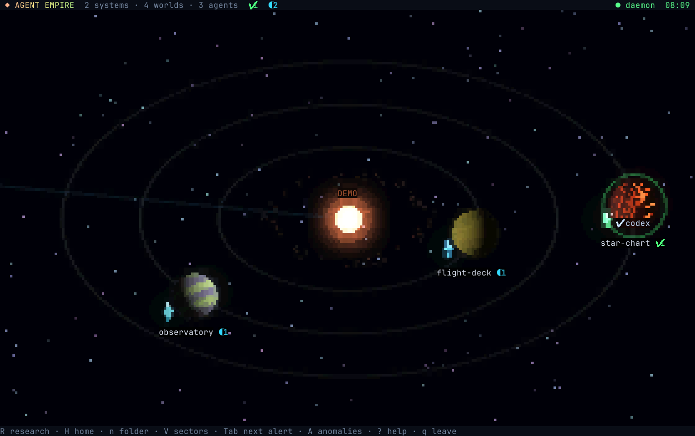
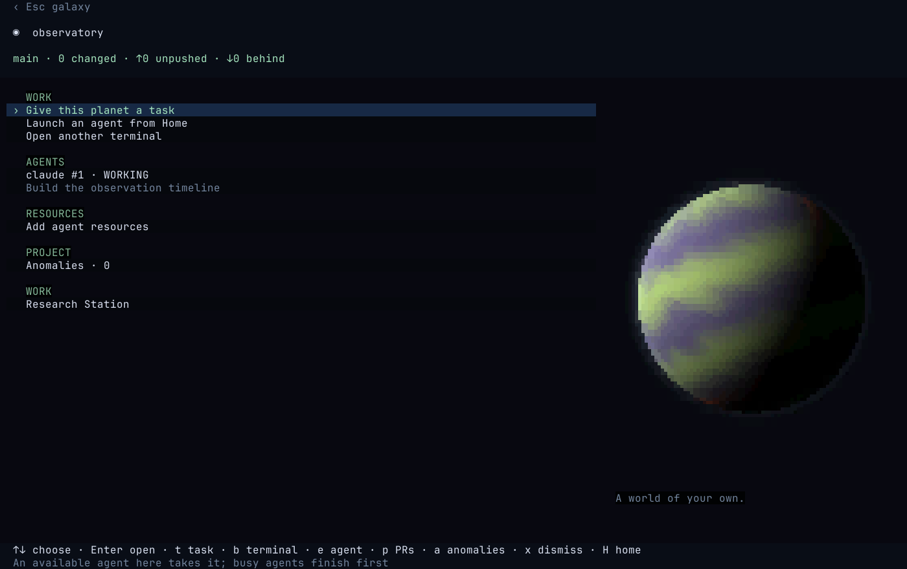

# Agent Empire

**Your projects are planets. Your coding agents are ships. You run the galaxy.**

Give Claude, Codex or Grok a task, open a terminal beside it, and move on to another world.
Empire keeps the sessions alive and shows you who is working, who needs an answer, and what is
ready to review. Come back to the same fleet when you reopen your terminal.



*A real render with fictional projects. Planets, ships, nebulae and sound are generated in code.*

[User guide](docs/guide/README.md) · [Get started](#get-started) · [Daily workflow](#your-first-flight) · [Controls](#galaxy-controls-and-atmosphere) · [Full manual](#home-and-your-projects) · [Contributing](CONTRIBUTING.md)

## A place for the work you have in flight

- **One map for many projects.** Folders become worlds, parent folders become systems, and Git
  worktrees orbit their projects as stations.
- **Your agents, in their native terminals.** Launch installed coding CLIs and keep their normal
  tools and permission prompts. Ordinary shells live alongside them for servers, tests and Git.
- **Tasks that wait their turn.** Queue a prompt for a project's next available agent, or launch
  a new ship. Jump to the next agent that needs your attention.
- **A workspace that stays put.** Close the galaxy without stopping your agents or development
  servers. Reopen it to reconnect.
- **Progress you can see.** Git changes, pull requests, project findings and agent resources have
  a place on the map. Procedural worlds and an ambient soundtrack make it feel like somewhere.



## Get started

Empire is early-stage software developed on **Linux**. It needs a recent stable Rust toolchain,
a C toolchain, `pkg-config`, ALSA development headers, Git, and a true-color terminal. A font with
Unicode 16 octant glyphs gives the intended graphics. Other operating systems are not currently
supported. Audio is optional at runtime; the build still needs the ALSA headers.

On Debian/Ubuntu, install the native build packages:

```sh
sudo apt install build-essential pkg-config libasound2-dev git
```

On Arch Linux:

```sh
sudo pacman -S --needed base-devel alsa-lib git
```

Install and authenticate at least one supported agent CLI (`claude`, `codex` or `grok`) separately.
Empire uses the executables on your `PATH`; it does not include model access or an AI subscription.
The GitHub station additionally uses an authenticated `gh` CLI. You can explore projects and use
ordinary terminals without an agent installed.

```sh
git clone https://github.com/Cozidian/agent-empire.git
cd agent-empire
cargo build --release --locked
./target/release/empire
```

To launch with `empire` from any terminal, link the release build into your user command directory
(which must be on your `PATH`). Run this from the repository root after building:

```sh
mkdir -p ~/.local/bin
ln -s "$PWD/target/release/empire" ~/.local/bin/empire
empire
```

The link uses this checkout's release build, so `cargo build --release` updates the command too.
Keep the checkout in place while using the link.

## Your first flight

1. Press **V**, then **n**, to add a folder containing your projects. Empire discovers repositories
   beneath it. Use **n** on the galaxy to add just one folder instead.
2. Select a planet and press **Enter**. Press **t** to give it a task or **e** to launch an agent.
3. Open the agent's native terminal to talk to it. **F12** or **Ctrl-]** returns to Empire.
4. Press **b** in the project to open a shell and run your tests or development server.
5. Press **q** from the galaxy when you're done looking around. Your sessions keep running.

New here? Press **?** on the galaxy for help. Closing the UI keeps sessions alive;
`empire stop` deliberately stops the daemon **and every session**.

## Home and your projects

Press **V** to manage **sectors and folders**, or choose **Manage sectors and folders** on
**Home** (`H`, then `r`). Press **n** in the manager to add a sector root: a folder containing
projects, for example `~/code`, `~/work`, or `/mnt/projects`. Add as many roots as you need;
each addition keeps the existing roots. **Tab** completes the path. Empire discovers Git repositories beneath
these folders and makes them planets. Their parent folders determine the sectors. Discovery runs
in the background, stops inside repositories, and skips hidden directories, symlink directories,
`node_modules`, `target`, and `vendor`. Git worktrees with a `.git` file are recognized too; each one is shown as a small space station
(`▣`) in close orbit around its project planet: a core module, a truss and two solar wings, with
amber lights while an agent is aboard and dark lights when it has none. It is distinct from the
ring-shaped GitHub station. Select and open them like any project.

While the galaxy is open, Empire also checks each repository's Git worktree registry during
its regular survey (about every eight seconds). Worktrees created by your agent appear as stations
automatically, including ones in hidden folders or outside your sector roots. Missing worktrees
are skipped; explicitly hidden stations stay hidden.

For Codex, the existing ship follows the working directory of completed commands recorded in its
local session log. Claude/Grok hooks can also report a changed native working directory. Empire
only follows checkouts of the same repository, keeps the ship ID and open conversation, and moves
unfinished missions assigned to that ship with it. Unassigned project tasks stay on their planet.
Ask your agent to create the worktree **and run its work there**: the station appears once Git
registers it, and the ship moves when execution there is observed. Empire does not interpret prompt
text, restart the agent, or change the harness's permissions or default directory. A command using
only `git -C` or a shell-internal `cd` may still report its original directory; use the worktree as
the command's working directory. Older Codex logs without execution-directory records cannot
report these moves automatically.

If no root has been saved, Empire uses `/home/code` or `~/code` when one exists. **R on Home**
rescans all roots. A scan reads directory entries; it does not pull, clone or modify repositories.

**n on the galaxy or Home** adds a single planet manually, including folders outside the roots
and folders without Git. To discover several projects under a folder, use **V**, then **n** instead.
A missing folder is created only after a second Enter. Adding a planet does not launch an agent.
In the sector manager, select a root or manually added planet and press **x/Delete** to remove it.
On Home, **x/Delete** removes the selected project; on the galaxy, **x** (or **Delete**) removes the
selected planet. This only removes it from the map: files, repositories, agents and terminals are kept.
Worlds with sessions stay visible until those sessions are dismissed. Removed projects stay hidden
from discovery and history; adding their folder again restores them. Removing a root keeps projects
covered by another root or added individually. Adding a root again restores its hidden projects.
An empty root stays listed in the manager until it contains Git projects to show on the map.

Manually added folders, roots and hidden projects are saved in `$XDG_STATE_HOME/empire/workspace.json`
(normally `~/.local/state/empire/workspace.json`). Existing projects from Empire's history and
running sessions remain visible unless explicitly removed as described above. Discovered projects stay
charted without requiring an agent.

Home puts projects needing you first, with clear input/check labels and their latest question or task.
Other projects use compact rows grouped by parent folder; only nonzero ship and terminal counts
are shown. The selected project's full path stays in the footer. Folder headings are not selectable.
Choose a project to open its workspace, or press **e** on its Home row to launch a ship.
**r on Home** manages sector roots and folders. New ships depart from Home and settle into the project's
orbit; they remain there between tasks until you dismiss them.

## Working on a planet

Enter or double-click a planet to open its workspace:

- **Give this planet a task** (`t`): write a short instruction. The next available agent on this
  planet takes it. If all agents are working, it waits; agents waiting for permission are not free.
  With no live agents, the composer defaults to launching a new ship. **Tab** switches between
  an available agent and a new ship; **↑↓** chooses Claude, Codex or Grok when launching.
- **Launch an agent from Home** (`e`): choose a species and open its native terminal.
- **Open another terminal** (`b`): start your normal shell in the project folder. Open as many
  as you need for `git pull`, development servers, logs and manual testing. Shells never take
  agent tasks or generate agent permission/completion alerts.
- **Agents** and **Terminals** have separate sections. Every terminal has a stable number and
  a fixed `Terminal #…` label. Shell keystrokes and window titles never become task labels or
  list previews, including input entered at password prompts. Select one and press **Enter** to reopen it; **F12** or **Ctrl-]**
  returns with that session selected. **b** opens another terminal. **x** closes the selected
  session after confirmation and keeps you on the project. Closing a shell stops its running
  commands too; cancelling leaves it running.
- **Anomalies** (`a`): inspect detected problems and reported discoveries on this planet.
- **Project resources**: browse `AGENTS.md`, `CLAUDE.md`, skills, subagents, commands, hooks, MCP
  configuration and other agents' instruction files. These buildings appear as small, warm
  city-light clusters on the planet's night side, fading out at distant zoom. More kinds of
  resources fill out the settlements; building names and files stay in the resource view.
  **Enter** or **e** opens the selected file in your editor (`$VISUAL`, `$EDITOR`, else
  nvim, vim, vi or nano) as a full terminal; quit the editor to come straight back with the
  file re-read, or step out with **F12** and pick it up again later (it's listed as an Editor
  under Terminals). On an empty plot, **Enter** or **n** lays a short first draft (`AGENTS.md`,
  `CLAUDE.md`, `.claude/skills/new-skill/SKILL.md`, `.mcp.json`…) and opens it; **n** on a kind
  that holds many adds another. Existing files are never overwritten. **B** instead briefs a
  ship to build or renovate it, as an ordinary task you can inspect before sending. **b** opens a
  terminal in the project, **c** opens comms with its lead ship, and **Ctrl+R** re-reads the files.

The project header shows branch, changed files and ahead/behind counts. Agent rows show their
current task or question. On wider terminals, selecting an agent with a handoff shows its actual
recent terminal output, including testing instructions when the agent provided them. This is an
excerpt, not an independently verified summary. Open the native terminal for the full conversation.

**Overlapping work (optional, automatic).** With `EMPIRE_ADVISOR_OVERLAP=1`, when two or more ships are
Working on one world, a configured advisor is asked, once per pair, whether
their tasks ask for the same work or work likely to edit the same files. At 0.7 or more both ships
get a dim `≈#7` in the outliner and an `overlap` row on the ship card. This comes earlier than
the red `⚔` border conflict, which still means files were really edited by both. It is only a
hint: nothing is asked of you or done for you. With the flag but no advisor configuration (or if Advisor fails), shared file paths or mostly shared words in
the two tasks stand in. Only the project basename, species and each task snippet (up to 300 characters)
are sent, never terminal text; a world is asked about at most once every 30 seconds. The model
(`advisor-1.14.0`) and endpoint can be overridden with `PROVIDER_DEFAULT_MODEL` and `PROVIDER_BASE_URL`.

## Native terminals and quick tasks

Every key in a native terminal, including **Esc** and **Ctrl+C**, goes to that session.
**Ctrl-]** or **F12** returns to the project or galaxy. Scrolling uses the application's own mouse
support when available, otherwise Empire's terminal history. Drag to select and copy text.
**Shift+Enter** is forwarded as a distinct key for agents' multiline prompts on terminals that
support enhanced keyboard input. **Enter** still sends; **Alt+Enter** and **Ctrl+J** are also
forwarded for agents that use those newline shortcuts.

The galaxy and terminal status bar adapts to the window width. Smaller windows shorten the
fleet summary and usage display, keeping connection status visible. Compact usage shows each
provider's most-used allowance window; meters, reset times and world counts return when space
allows. At the narrowest sizes, usage and quiet ship tallies give way to agents needing you.

In the planet task composer, **Enter** sends; **Alt+Enter**, **Shift+Enter** or **Ctrl+J** adds a
line. Pasted line breaks are preserved. **Ctrl+V** pastes clipboard text or attaches a screenshot.
**Tab** switches destination. **Up/Down** moves through prompt lines and selects the previous/next
species at the first/last line, matching the species picker's **↑/↓** arrows.
Drop image paths, or type an image path and use **Ctrl+O**. **Ctrl+X** removes the last attachment.
Up to eight images, 20 MiB each, are copied to Empire's private screenshot directory so queued
tasks still work if the originals move. Failed delivery keeps the draft. Cancelling removes
unsent image copies. Agents need their own image-viewing tools to inspect attachments.

Tasks go to one available agent in the exact project folder. **L** on the galaxy opens the
planet's task history. A finished agent turn means **ready to check**; it does not mean that
implementation or testing succeeded. You remain in charge of testing, committing and pushing.

## Attention and discoveries

Ships and planets highlight agents needing an answer or ready for you to check. **Tab** on the
galaxy selects the next agent needing you; **C** opens the attention list across projects.
Permission questions remain incoming transmissions, with the command the agent wants to run shown
in full and highlighted; number keys answer the displayed choices and **c** opens comms with the ship.
When the galaxy is closed, desktop notifications report questions and completed longer turns.

**Outcome tags (optional, automatic).** "Done" only means a turn ended. With
`EMPIRE_ADVISOR_OUTCOME=1`, a turn longer than 15 seconds is read once its output settles. If the
output holds the agent's own summary, Provider's Advisor model (`PROVIDER_API_KEY`) judges whether
the work looks failed, partial or needs review. A confident warning (0.4 or more) shows as "Looks
failed" or "Partly done" instead of "Ready to check" on Home, in the needs list, higher in the
attention list and on the mission log row, and is saved with the mission. It never shows a good-news
badge, never asks anything and does nothing for you; low confidence, no summary or any error shows
nothing. With the flag but no key (or if Advisor fails) a keyword scan stands in (`error:`, `failed`,
`panicked`; `remaining`, `skipped`, `TODO`; `please review`). The last 1500 characters of the
screen, with secrets blanked, are sent to Provider. `PROVIDER_DEFAULT_MODEL` and `PROVIDER_BASE_URL`
override the model (`advisor-1.14.0`) and endpoint.

**A** opens anomalies across the galaxy; a planet's **a** action filters to that project.
Anomalies include failing CI and unresolved Git conflicts, plus findings reported by you or an
agent: bugs, unclear code, missing documentation and improvement opportunities. Each preserves
its source and evidence. Reported findings are labelled as not independently verified.

Select a finding and press **t** to prepare an investigation as an ordinary planet task. Its
brief asks for read-only investigation; the agent retains its native permissions. Review and edit
before sending. **x** dismisses, **d** defers, **r** resolves, **o** reopens. Automatic findings resolve only
when a fresh survey confirms recovery. A finished investigation does not prove resolution.
Use **v** to include resolved/dismissed history, **f** to filter kinds, **/** to search and
**Backspace** to reset the filters.

Record a discovery without starting the daemon:

```sh
empire anomaly /path/to/project 'Confusing login flow' \
  'The callback discards the original destination; see src/auth.rs.' 'agent report'
```

## GitHub station

Projects with GitHub remotes connect to the **GitHub station**. Open it to browse project PRs
and CI status. **Tab** switches between all PRs, reviews requested from you, and your PRs.
**Enter** opens a PR in your browser. **t** prepares a task on that PR's planet: review someone
else's PR, fix failing checks, or address review feedback. Review tasks ask the agent to report
findings without posting anything. Inspect the instruction before sending.

The station uses your installed `gh` and its existing authentication. It refreshes up to 100 of
your open PRs and 100 other open PRs per project every 150 seconds, and marks stale cached results
when GitHub is unavailable. Unpushed commits still appear as freighters travelling to the station.

Planets with open pull requests show a fixed **◇ PR N** marker beside their map name and in the
outliner, including planets without agents. It counts both your PRs and other people's PRs.
**!** in red means your PRs have failing checks; **↗** in amber means a non-draft PR requests your
review. Failing checks take priority if both apply. A quiet blue marker means open PRs with neither
signal; passing checks alone do not imply a PR is ready to merge. **?** marks unavailable or cached
data (including a successful check more than 7½ minutes old); a checked repository with no open PRs
has no marker. These signals use symbols as well as colour and do not blink or orbit.

Click the marker or select a planet and press **p** to open only that repository's PRs. **Tab**
still switches all/review/mine within that repository. **p** also works on a selected Home project
and inside its workspace, which has a **Pull requests** action. **Esc** returns to where you opened
the list. The GitHub station still opens the global overview. Worktrees share their parent planet's
count, so their space-station markers remain distinct and do not duplicate PR counts.

## Galaxy controls and atmosphere

| Key | Action |
| --- | --- |
| Enter / double-click | Open planet workspace or native agent terminal |
| t / b / e | Give the selected planet a task / open a new terminal there / launch an agent |
| c / 1-9 | Comms with the incoming transmission (else the selected ship) / answer it |
| x | Dismiss the selected ship (with confirmation) / remove the selected planet from the map |
| i | Ship information |
| Tab / C | Next agent needing you / attention list |
| H / n | Home / add a project folder |
| V | Manage sectors and folders: n adds a root, x/Delete removes an entry |
| p / click ◇ PR | Open the selected planet's repository PRs |
| R / A | Research Station: experiments, evidence and resource proposals / anomalies |
| L / S | Selected planet's task history / situation log |
| ↑↓ / j k / g G | Select in the outliner / first / last |
| wasd / drag | Pan |
| ± / wheel | Zoom between systems, sectors and planets |
| z / f | Fit galaxy / focus selection |
| o | Toggle outliner |
| m / M | Mute alerts / mute music |
| ? / q | Help / leave the galaxy |

The galaxy overview can zoom out to six times the previous visible span. Keep scrolling down
or pressing **-** to pull back; **z** fits the whole galaxy using the same expanded range.

Planets retain their seeded procedural appearance, with curved daylight shading, soft atmosphere,
ocean glints and drifting cloud banks. Fitted two-colour octant cells give surfaces and glows smoother
gradients; small worlds receive a little extra light to stay readable on the map.
Useful progress adds rings, city lights and
other development without a separate management workflow. Music and operational cues are synthesized
locally. The cues are a starship bridge, apart from the score: a signal drawing near, a hyperlane arrival,
a tone rising to rest, an anomaly pulse, a contact fading and a low tone lifting an octave. Music starts
when the galaxy opens and stops when you leave. The score is composed
on the fly and never repeats: slow, hopeful chord changes in a drifting key, with sections
that move between pads, strings and a wordless choir. Echoing arpeggios, soft chimes and an
improvised lead melody join once each section settles. Home and the project
workspace show larger planetary portraits when there is enough room.
Muting music fades it out, then skips inaudible synthesis while the score's clock keeps moving;
unmuting fades back into the current passage. Alert sounds remain independent.

Campaigns, expeditions, ship designs/refits, prescribed launch roles, fleet orders, manual
hyperlane/sector editors and worktree creation/merging are retired from the workspace. Existing
folders, worktrees and saved records are not deleted. The daemon retains legacy wire fields and
session outfits so existing agents can survive upgrades. Campaign automation no longer dispatches
stages. Worktrees you already have still appear as space stations.

## Persistence and commands

The daemon owns agent and shell PTYs. **Closing the galaxy leaves them running**, including
servers started in ordinary terminals. Reopening reconnects. A new build can hot-upgrade the
daemon in place, keeping its PID and terminal file descriptors.

After a reboot or daemon crash, supported agents resume their recorded conversations. Ordinary
shells reopen in their original project folders; commands and development servers cannot survive
a reboot and must be started again. A deliberate `empire stop` closes every session and clears
the resume registry—do not use it merely to close the galaxy.

```sh
empire status          # status-bar summary
empire status --json   # Waybar-compatible JSON
empire upgrade         # hot-upgrade the daemon
empire sounds          # preview sound cues
```

State lives under `$XDG_STATE_HOME/empire` (normally `~/.local/state/empire`): workspace settings,
session registry, tasks, discoveries, screenshots, progress and visited projects.

To make a local build available on PATH:

```sh
mkdir -p "$HOME/.local/bin"
ln -s "$PWD/target/release/empire" "$HOME/.local/bin/empire"
```

## User guide site

The [user guide](docs/guide/README.md) provides eleven chapters for setup and daily use, with
chapter navigation, keyboard reference and local search. It builds into static HTML for GitHub
Pages, with no extra package dependencies:

```sh
python3 tools/build-docs.py
python3 -m http.server 8765 --bind 127.0.0.1 --directory target/docs
```

Open `http://127.0.0.1:8765/`. The [guide README](docs/guide/README.md) explains editing and Pages
setup. The deployment workflow stays disabled until `PAGES_ENABLED=true` is configured after
release cleanup. Keep the guide and this manual in step when behavior changes.

## Development

For a long-run performance trace, open the galaxy with:

```sh
EMPIRE_PERF_DIR=/tmp/empire-perf empire
```

This opt-in recorder writes a separate `ui-PID-TIMESTAMP.jsonl` file per launch, with a sample
every 10 seconds and a final partial sample on normal exit. It records CPU usage (100% = one core),
resident/peak memory, busy threads, frame rate, and frame timings grouped by view and terminal size.
`mean_ms` and `max_ms` contain update, draw, and terminal-presentation wall times in that order;
they exclude frame pacing and are not CPU times. The last-frame context includes zoom, object
counts and audio settings. No terminal contents, prompts or project paths are logged.
Logging stops at 8 MiB per launch, or on a write error, with a toast; it never overwrites earlier logs.
Omit `EMPIRE_PERF_DIR` to disable tracing. After building a new version, close and reopen only the
galaxy to enable it; the daemon and agent sessions can stay running.

The glow pass runs serially to avoid waking rendering workers every frame; graphics and the
30 FPS target are unchanged. Repeatable component benchmarks (run separately) are available with
`cargo test bloom_cpu_cost -- --ignored --nocapture` and
`cargo test muted_music_cpu_cost -- --ignored --nocapture`.

Single Rust binary crate. `game.rs` handles the model/input, `draw.rs` renders it, `workspace.rs`
discovers projects, `daemon.rs` owns terminals, `proto.rs`/`client.rs` connect them, `survey.rs`
reads Git/GitHub status, and `anomaly.rs` stores findings. Graphics and sound are procedural.

```sh
cargo test
cargo build --release
```

Do not run `cargo fmt`; follow the existing compact style. Runtime tests must use isolated socket
and state paths, for example:

```sh
EMPIRE_SOCK=/tmp/empire-dev.sock XDG_STATE_HOME=/tmp/empire-dev ./target/release/empire
```

Never stop or alter the user's real daemon or state during tests.

### Graphics comparison

`cargo run --release -- graphics` opens an offline, animated comparison with fixed example
worlds at portrait and map sizes. **Space** switches between the polished renderer and the classic look;
**p** freezes rotation for comparison, and **q / Esc** leaves. It never connects to the daemon,
starts agents or audio, or reads/writes workspace state.

The polished renderer is the default in the galaxy and planetary portraits. The comparison keeps
the same procedural world identities and terminal resolution for both looks. The example worlds
have five building kinds, showing city lights at portrait and map sizes.

For reproducible 140×48 terminal captures, use `empire graphics --snapshot` and
`empire graphics --snapshot --classic` (ANSI output, fixed animation time).

## Research Station

**R** on the galaxy map, **Research Station** on Home or a project, or `empire research`
opens a standalone laboratory. Its teal orbital marker lives outside planetary systems. It is
independent of worktree stations and the fleet: leaving the screen keeps an experiment running.
The standalone command never starts or upgrades the Empire daemon.

1. Press **i** once to install the pinned [Google Harness²](https://github.com/google-research/harness2)
   runtime (or run `empire research setup`). This needs `git`, `uv`, and network access. It uses
   Python 3.12 in its own environment; your project dependencies are not changed.
2. Press **n**. Describe the problem, choose a project folder and a commit/ref (default `HEAD`),
   (**↑↓** in the project field selects a discovered project; typing/pasting a path also works),
   and enter **1–3 representative tasks**, one per line. **Alt+Enter** adds a task; pasted newlines
   work too. **Tab** moves fields. Set a time budget, then **Enter** to review the frozen commit,
   tasks and limits. **Enter** again starts it; **Esc** returns to editing.
3. Watch snapshot → baseline → proposals → trials → composition → review. The current stage
   is highlighted; the experiment trail records completed and failed sessions. **Enter** opens a study,
   **v** reads its evidence report, **p** reads its resource patch, and **o** returns to progress.
   **↑↓ / PgUp / PgDn** scroll. **x**, then **y**, cancels with evidence retained.
4. Review the report and patch. From the patch, **a**, then **y**, applies the proposed resource
   changes to the original project. Every original resource must still match the snapshot;
   conflicts refuse the entire application. No commit, push, or broad rollout happens automatically.
   The saved patch can also be reviewed and transferred manually to another project.

Research screens use a centered reading column, section headings and highlighted selections.
Brief fields wrap across lines and keep the active cursor in view; **Shift+Tab** moves to the
previous field and **Ctrl+Enter** reviews the brief. Evidence reports distinguish headings,
execution references and code; patches mark additions in green and removals in red, retaining
their `+`/`-` signs. The footer shows complete, contextual actions and the current scroll range
when content continues below. Adoption and cancellation open a separate, scrollable confirmation
with the target and consequences; **y** confirms, **n / Esc** returns.

A useful first question: “My agents keep missing layout problems when they finish UI work.
Investigate a better verification workflow.” Choose a small UI change whose acceptance criteria
explicitly include narrow and wide layouts, and ensure its dependencies/checks can run offline.

This first version uses Harness²'s **single-step aggregate schedule** and the **native Codex CLI**
for both task execution and instruction improvement. It uses your existing `codex login` account.
Each task normally takes eight model sessions (four executions, three resource edits, one
reflection); the hard ceiling is ten calls per task, 30 minutes by default, and ten minutes per
session. One experiment runs at a time. Calls are serialized, so this is intentionally a small
research workflow, not a replacement fleet scheduler.

Trials get separate copies of the chosen Git commit. Uncommitted/untracked files, symlinks,
`.env`/`.env.*`, `.codex` and `.mcp.json` are excluded. Codex runs with `workspace-write`, network
access disabled for task commands, escalation denied, and user configuration ignored. Model
requests still need network access and your account authentication. Global instructions/skills may
still apply; `environment.json` records the runtime versions and traces retain the observed context. This is a workspace write
boundary, not a confidentiality sandbox: only use suitable source/tasks. Dependencies are not
automatically downloaded; tasks that need a local server or browser must have usable tooling.
Failures and incomplete checks remain evidence, never a silent success.

Editable resources are `AGENTS.md`, `.agents/skills/<name>/SKILL.md`, Python helpers under
`.agents/skills/<name>/scripts/`, and `scripts/*.py`. Supporting skill documents stay intact. Application changes made during trials stay in the experiment copies. Harness² retains
experience across tasks **within a study**; studies do not silently share learned resources.
The final task's selected candidate becomes the proposal. This is model-selected evidence,
**not an independent proof that the workflow improved**: compare baseline/candidate traces and
validate on fresh tasks before wider adoption.

Records, snapshots, candidate workspaces, model traces, `REPORT.md`, `proposal.json` and
`proposal.patch` live under `$XDG_STATE_HOME/empire/research/RUN-ID`. Runtime dependencies live
under `$XDG_DATA_HOME/empire/research`. Native CLI input/output/cache token counts are recorded;
**billed cost is unavailable**, rather than reported as zero. Check your account usage for cost.
For an existing compatible environment, set `EMPIRE_RESEARCH_PYTHON=/path/to/python`.

For scripted starts, `empire research start REQUEST.json` accepts:

```json
{
  "problem": "Improve verification of narrow layouts",
  "project": "/absolute/path/to/project",
  "revision": "HEAD",
  "tasks": ["Implement a compact settings panel; check it at 390 and 1280 pixels and report evidence."],
  "minutes": 30
}
```

`empire research --snapshot` renders the empty station offline at 140×48. Python runner tests
need the research environment: `PATH/TO/research/venv/bin/python -m unittest discover -s research -v`.
They include the actual Harness² schedule with a clearly marked model test double; no paid model
calls are made by the unit tests.

## Privacy and trust

Empire is a local, single-user controller for processes running as your Linux user. The daemon
checks the user ID of both ends of its Unix-socket connection. The socket is mode `0600`, and the
daemon's state directory is mode `0700`. This is not a sandbox against other processes running
as you. Agent permissions and isolation are provided by each agent's own harness.

Task text, agent output, screenshots and project paths can be saved in the state directory.
Native agent CLIs keep their own histories and send requests to their configured providers.
GitHub features use `gh`; optional Research Station setup downloads its own tools and research
runs invoke model clients. Review screenshots, logs and study traces before sharing them.
See [SECURITY.md](SECURITY.md) for reporting and scope.

## License

[MIT](LICENSE) © 2026 Cozidian and contributors. Agent CLIs and optional research tools are
separate projects with their own licenses and terms.

### Optional advisor

Advisor features are off by default. They require `curl`, `PROVIDER_API_KEY`, an explicit
`PROVIDER_BASE_URL` for a compatible typed-decision API (`POST /v1/advice`), and a feature flag.
This is a specialized API, not an OpenAI-compatible chat endpoint. `PROVIDER_DEFAULT_MODEL`
selects the model (default `advisor-1.14.0`); set it to one your service supports.

`EMPIRE_ADVISOR_SEVERITY=1` sends report titles, evidence and project basenames to that service
to order reported anomalies by severity. Other finding kinds keep their fixed priorities.
Errors and uncertain answers leave the existing behavior intact. Treat report text as potentially
sensitive before enabling this. `EMPIRE_ADVISOR_LOG=1` records decision labels in a private
`advisor.log` in the state directory. No advisor is needed to play or run agents.

`EMPIRE_ADVISOR_ROUTE=1` suggests an installed species while you compose a task. After the
text pauses for one second, it sends the project basename and up to 4,000 characters of task
text. A confident answer can preselect a species, but a species you choose manually wins.
It never sends the mission; press Enter when you are ready.
